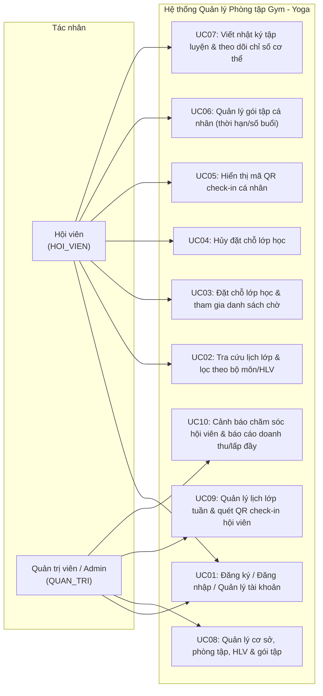
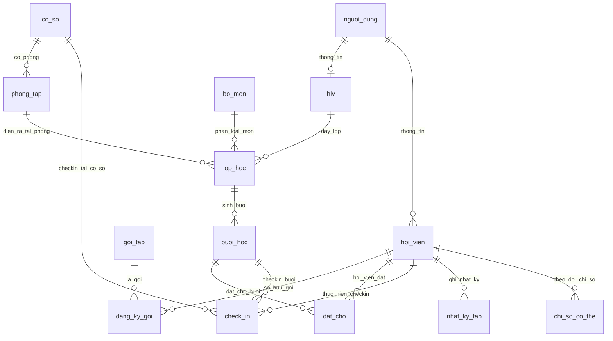

# HỒ SƠ MỐC TUẦN 9: CHỐT PHÂN TÍCH HỆ THỐNG

**Học phần:** INT4211 - Phát triển ứng dụng di động và phân tán  
**Đề tài:** Đề 19 – Hệ thống quản lý phòng tập gym – yoga  
**Nhóm thực hiện:** Nhóm NoName  

---

## 1. Danh sách thành viên & Phân công nhiệm vụ chính thức (Nhóm NoName)

| STT | Họ và tên | MSSV | GitHub Username | Vai trò phụ trách |
| :---: | :--- | :---: | :--- | :--- |
| **1** | Huỳnh Ngọc Lâm | 221A010237 | L1ly | **Backend & Admin Lead:** - Xây dựng API xác thực JWT và quản lý hệ thống. - Lập trình API đặt chỗ lớp học áp dụng Transaction xử lý danh sách chờ tự động. - Xây dựng API quét mã QR check-in và báo cáo thống kê. - Triển khai hạ tầng Backend lên Render. |
| **2** | Huỳnh Ngọc Hiếu | 241A010537 | hinhgiahieu-byte | **Client Mobile Dev (Flutter):** - Xây dựng module Đăng nhập / Đăng ký tài khoản. - Phát triển giao diện xem lịch lớp học theo tuần. - Xây dựng tính năng đặt chỗ lớp học và tham gia danh sách chờ. - Lập trình tính năng hiển thị mã QR check-in cá nhân và quản lý thông tin gói tập. |
| **3** | Lương Văn Đô | 241A010541 | luongvando100-dotcom | **Client Mobile Dev (Flutter):** - Xây dựng module Đăng nhập / Đăng ký tài khoản. - Phát triển giao diện xem lịch lớp học theo tuần. - Xây dựng tính năng đặt chỗ lớp học và tham gia danh sách chờ. - Lập trình tính năng hiển thị mã QR check-in cá nhân và quản lý thông tin gói tập. |
| **4** | Trần Nguyễn Đức Anh | 241A010625 | DucAnh53 | **Client Mobile Dev (Flutter):** - Xây dựng màn hình Nhật ký tập luyện (ghi chú bài tập, số set, rep, mức tạ). - Phát triển tính năng theo dõi chỉ số cơ thể (cân nặng, tỷ lệ mỡ,...). - Xây dựng màn hình quản lý lịch sử tập luyện. - Lập trình tính năng tra cứu và thao tác hủy đặt chỗ lớp học. |

---

## 2. Sơ đồ Use Case tổng thể hệ thống (10 Use Case - Đề 19)

Hệ thống phục vụ 2 nhóm tác nhân chính:
1. **`HOI_VIEN` (Hội viên / Khách hàng):** Tra cứu lịch lớp, đặt chỗ (hoặc vào danh sách chờ), xuất mã QR check-in, ghi nhật ký tập luyện, theo dõi chỉ số cơ thể.
2. **`QUAN_TRI` (Quản trị viên / Nhân viên phòng tập):** Quản lý cơ sở, HLV, gói tập, lịch lớp học, quét mã QR check-in hội viên, theo dõi cảnh báo chăm sóc và báo cáo doanh thu.

---
## 3. Sơ đồ Thực thể - Quan hệ (ERD Các Bảng Nghiệp Vụ)

---
4. Tóm tắt giải pháp kỹ thuật chính
Chống vượt sức chứa lớp học (Overbooking Prevention & Danh sách chờ tự động):

Áp dụng Transaction trong PostgreSQL với mức cô lập mạnh, sử dụng câu lệnh SELECT suc_chua FROM phong_tap WHERE id = $1 FOR UPDATE.

Tính toán trực tiếp số lượng hội viên đã đặt chỗ hợp lệ bằng lệnh tổng hợp SELECT COUNT(*) FROM dat_cho WHERE buoi_hoc_id = $1 AND trang_thai = 'DA_DAT'.

Nếu đã đạt tối đa sức chứa phòng, hệ thống tự động đưa hội viên vào trạng thái chờ (CHO); khi có hội viên hủy chỗ (HUY), người ở đầu danh sách chờ được tự động đôn lên thành DA_DAT trong cùng một Transaction.

Kiểm soát Check-in qua Mã QR & Gói tập:

Mỗi hội viên sở hữu một mã QR định dạng chuẩn duy nhất gắn liền với tài khoản.

Khi quét mã tại quầy lễ tân (App Admin), hệ thống kiểm tra tự động trạng thái hiệu lực của bảng dang_ky_goi (hạn ngày ket_thuc và so_buoi_con > 0). Nếu hợp lệ, ghi nhận vào bảng check_in; ngược lại, hệ thống từ chối check-in ngay lập tức.

Cảnh báo chăm sóc hội viên tự động:

Xây dựng các API truy vấn quét dữ liệu hội viên không đến phòng tập quá 14 ngày dựa trên bảng check_in hoặc hội viên có gói tập sắp hết hạn trong vòng 7 ngày tới, hỗ trợ ban quản lý chăm sóc khách hàng kịp thời.
    
